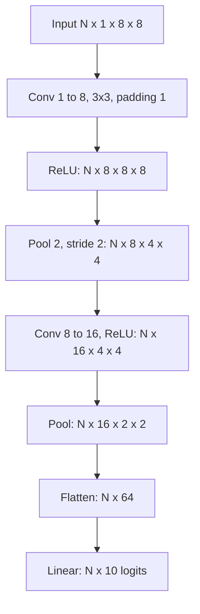
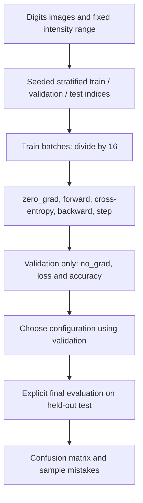

# Documentation Volume 3 — Convolutional Neural Networks

**DeepLearningStudio M5 — educational reference and practical user guide**

## 1. Why CNNs?

A dense model first flattens an image. An 8×8 grayscale image becomes 64 features, and a `Linear(64, 128)` layer learns 8,320 parameters including bias. A CNN instead scans a small shared filter across the image. `Conv2d(1, 8, 3, padding=1)` learns just `8 × (1 × 3 × 3 + 1) = 80` parameters and preserves spatial organization. Parameter sharing, local receptive fields and hierarchical feature extraction are the defining differences.

## 2. Images as tensors

PyTorch stores image batches in **NCHW** order:

- N: batch size, number of images processed together
- C: image channels, 1 for grayscale and 3 for RGB
- H: image height in pixels
- W: image width in pixels

A batch of 32 RGB 28×28 images has shape `[32, 3, 28, 28]`. The scikit-learn Digits dataset consists of 8×8 grayscale images. Its original intensities are in the known range 0 to 16; dividing by 16 maps values into `[0,1]` without estimating a statistic on validation/test data.

## 3. Convolution versus cross-correlation

A `Conv2d` filter has one kernel for each input channel. For each output position it multiplies corresponding input window and kernel entries, sums them over spatial positions **and** input channels, and optionally adds a bias. PyTorch `Conv2d` implements **cross-correlation**, which does **not** flip the kernel; the common CNN term “convolution” follows machine-learning convention.

For output channel `o` at image position `(i,j)`:

```text
Y[n,o,i,j] = bias[o] + sum over c,u,v of
              W[o,c,u,v] * X_padded[n,c,i*stride_h+u*dilation_h,
                                      j*stride_w+v*dilation_w]
```

The bias term is omitted when disabled. PyTorch weight shape is `[output_channels, input_channels, kernel_height, kernel_width]` for standard ungrouped convolutions. This studio deliberately does not introduce grouped or depthwise convolution in M5.

### Hand calculation: 4×4 input with a 2×2 filter

```text
Image                  Kernel
1   2   3   4          1   0
5   6   7   8          0  -1
9  10  11  12
13 14  15  16
```

At the first output position, the top-left window is `[[1,2],[5,6]]`.

```text
1*1 + 2*0 + 5*0 + 6*(-1) = -5
```

With stride 1 and padding 0, output is 3×3, with each value -5. Try this using the **Convolution explorer** with a custom 2×2 kernel `[1,0,0,-1]`, input size 4, a single channel, padding 0, stride 1, and a zero bias. Note that the explorer's default image is scaled by its height, so multiply the displayed values by four to compare with the exact integer example; the automated test uses the literal integer input.

### Multi-channel calculation

For RGB (`Cin=3`), a single output filter contains three kernels. At each location compute `sum(input_red * kernel_red)`, `sum(input_green * kernel_green)`, and `sum(input_blue * kernel_blue)`, then add their sums and the one output-channel bias. Multiple output filters perform separate calculations and produce distinct output feature maps.

## 4. Stride, padding, dilation and output sizes

For each spatial dimension separately:

```text
output = floor((input + 2*padding - dilation*(kernel-1) - 1)/stride + 1)
```

For example, height 8, kernel 3, stride 1, padding 1, dilation 1: `floor((8+2-1*(3-1)-1)/1+1) = 8`. For width 12, kernel width 5, stride 2, padding 0: `floor((12-4-1)/2+1) = 4`.

Changing stride skips some possible window positions and shrinks output size. Padding preserves border context or desired dimensions. Dilation spreads sampled kernel cells farther apart without increasing learned parameter count.

## 5. Feature maps, ReLU, and filter examples

A feature map is the response of one learned filter across all spatial positions. Each filter can emphasize certain patterns. Manually constructed demonstrations are **not** the same as weights obtained from learning:

```text
Identity:         Vertical edge:     Horizontal edge:
0 0 0              -1  0  1           -1 -1 -1
0 1 0              -1  0  1            0  0  0
0 0 0              -1  0  1            1  1  1

Blur:             Sharpen:
1/9 1/9 1/9        0 -1  0
1/9 1/9 1/9       -1  5 -1
1/9 1/9 1/9        0 -1  0
```

The activation `ReLU(z) = max(0,z)` clips negative feature-map values, providing nonlinearity. A model can learn an orientation-selective or more complex filter. Some learned kernels are difficult to interpret visually because they operate on intermediate feature channels, not raw images.

## 6. Pooling

Max pooling selects the largest value in a window. Average pooling computes its arithmetic average.

```text
Window:  1  4
         6  2

MaxPool = 6        AvgPool = (1+4+6+2)/4 = 3.25
```

For zero padding, dilation 1, and `ceil_mode=False`:

```text
Hout = floor((Hin - Kh)/Sh + 1)
Wout = floor((Win - Kw)/Sw + 1)
```

Pooling usually reduces spatial size, lowering work for later layers. Local translation tolerance is limited: a moved feature may retain a similar maximum within the same pooling window, but pooling is **not** general translation invariance. Pooling has no trainable weights.

## 7. CNN architecture walkthrough

The Digits training model follows this pipeline:

```text
Input                [N, 1, 8, 8]
  ↓ Conv2d(1,8,3,pad=1) [N, 8, 8, 8]       80 params
  ↓ ReLU              [N, 8, 8, 8]
  ↓ MaxPool2d(2,2)    [N, 8, 4, 4]
  ↓ Conv2d(8,16,3,pad=1) [N, 16, 4, 4]  1168 params
  ↓ ReLU              [N, 16, 4, 4]
  ↓ MaxPool2d(2,2)    [N, 16, 2, 2]
  ↓ Flatten           [N, 64]
  ↓ Linear(64,10)     [N, 10]             650 params
                                          ----------
                                          1898 params
```

The fully connected layer's 64 input features are *inferred*, not a fixed value. Changing input dimensions, kernel, padding, strides or channel counts changes the propagated shapes. An invalid intermediate shape is rejected before constructing the PyTorch model.

In PyTorch, linear `nn.Linear(in_features, out_features)` weight shape is `[out_features, in_features]`. A CNN model's final ten values are unnormalized **class logits**. The predicted class is `argmax(logits)`.

## 8. Training process and loss

Digits uses a deterministic, stratified partition into approximately 70% training, 15% validation, 15% test. A fixed pixel divisor of 16 provides image normalization without leakage. No validation or test example appears in training mini-batches. The test set stays held out until the learner selects **Evaluate held-out test set**.

For an example whose true class is `t`, cross-entropy is:

```text
L = -log(exp(logit[t]) / sum_j(exp(logit[j])))
```

`torch.nn.CrossEntropyLoss` accepts raw logits and class indices (not one-hot targets). For each mini-batch:

```python
optimizer.zero_grad(set_to_none=True)
logits = model(images)
loss = torch.nn.functional.cross_entropy(logits, targets)
loss.backward()
optimizer.step()
```

The history shows training and validation loss/accuracy and average convolutional gradient norms. Each epoch uses the training split only for updates. The test confusion matrix displays actual classes in rows and predicted classes in columns. Incorrect samples reveal patterns the classifier has not learned well.

## 9. Backpropagation through convolution

Every filter weight participates in several window computations; autograd accumulates the derivative contribution from all uses. The chain rule propagates gradients from cross-entropy through the linear head, Flatten, pooling, ReLU and convolutional weights and inputs.

With plain SGD:

```text
grad = ∂Loss/∂W
W_new = W_old - learning_rate * grad
```

Biases follow the same rule. The Backpropagation tab captures weights and gradients before `optimizer.step()` and then shows the updated values. Compare numbers to verify the equation. Adam instead maintains adaptive estimates of first and second gradient moments; its update is not exactly the displayed SGD equation.

### Numerical verification

For a small double-precision convolution, perturb one input or weight by `±epsilon` and approximate its derivative by:

```text
(f(x + epsilon) - f(x - epsilon)) / (2*epsilon)
```

The Backpropagation section offers a deterministic numerical-check button, and the automated CNN test uses PyTorch `gradcheck` to compare numerical derivatives against autograd. This is a teaching validation on a tiny deterministic expression, not a proof that every arbitrary CNN model is numerically stable.

## 10. Step-by-step platform tutorials

**Convolution explorer:** Open Learning Studio → CNN → Convolution explorer. Start with one channel, a 3×3 vertical-edge filter, stride 1, padding 1. Move output row/column. The “Selected padded window” and “Window × kernel” tables show the exact dot product. Switch to RGB channels and observe per-channel contributions. Increase filters to see separate maps. Toggle ReLU to see which negative values become zero.

**Pooling explorer:** Switch between Max and Average with the same feature map. Move the selected window and predict its pooled value before reading the result. Increase stride to show fewer output positions. Compare the two summaries on the same 2×2 region.

**Architecture builder:** Configure channels, input size, one to three convolution blocks, their widths and optional dense hidden layers, kernel size, padding, pooling type and number of class outputs. Inspect each computed shape and parameter count. Try a configuration that collapses spatial dimensions to see validation reject it. Download the JSON representation; it uses CNN schema v2 and does not modify old M4 ModelSpec JSON.

**Backpropagation:** Start with SGD learning rate 0.01. Pick a convolutional weight parameter, read its gradient L2 norm and inspect the old, gradient and new values. Verify at least one value manually. Compare a smaller learning rate to understand step size.

**Training laboratory:** Run five epochs on Digits using Adam. Review separate loss and accuracy curves for training and validation. Compare the initial and learned filter from the first convolution block. When ready, select **Evaluate held-out test set** and inspect the confusion matrix, examples and mistakes. Retest with SGD to see how optimization differs.

**Quiz and progress:** Answer the twelve CNN questions, save observations, and export the progress file. A previously exported M4 JSON file remains importable. Completing CNN adds `cnn` to the existing completed-lessons list without deleting older completions or quiz scores.

## 11. Troubleshooting and limitations

| Symptom | What to check |
|---|---|
| Invalid kernel shape | Kernel height/width must fit padded input. Reduce kernel or increase padding/image size. |
| Negative computed output | This is normal before ReLU. ReLU maps negative values to zero. |
| Architecture does not build | Inspect shape propagation: two pooling blocks may make the feature map too small. |
| Training takes a while | Use fewer filters/epochs; CPU is sufficient for Digits. |
| Test accuracy lower than validation | A small dataset and random variation can make estimates differ. Do not tune repeatedly against test results. |
| Flat loss curve | Compare learning rate, optimizer, gradient norms and filter sizes. |
| Imported progress appears empty | Export JSON from original v4 interface and ensure the file has `schema_version: 1`. |
| ONNX or Netron | M5 does not extend the existing v3 ONNX export path to CNN; existing v3 export should remain separate. |

## 12. Comparison and further reading

| Feature | Dense networks | CNNs |
|---|---| 
| Spatial structure | Typically flattened input | Preserves local neighborhoods |
| Parameter sharing | Different weight per input-output pair | Same filter reused across spatial positions |
| Typical input | Structured vectors, tabular features | Images and spatial tensors |
| Invariance | Not inherent | Limited shift tolerance, especially with pooling |
| Output head | Dense layers | Often convolution blocks followed by dense logits |

Future roadmap: RNN, LSTM, embedding network, single-head and multi-head attention, Transformer encoder/decoder, and Mini GPT. The framework-neutral specification can be interpreted by a future TensorFlow/Keras adapter; that adapter is **not included** in M5.

## 13. Complete topic reference

### 1. Images as tensors

A pixel is a number. An 8×8 digit is 64 intensities; a batch of 32 grayscale digits has shape [32,1,8,8]. Digits intensities range from 0 to 16; x = pixel/16 maps them to [0,1].

### 2. Grayscale and RGB

Grayscale has one intensity channel; RGB has separate red, green and blue planes. One 6×8 RGB image has shape [1,3,6,8], containing 144 numbers. Changing a red pixel changes only its red-channel entry.

### 3. Input and output channels

Each filter sees every input channel and produces one output channel. Weights have shape [C_out,C_in,K_h,K_w]. Four filters on RGB with 3×3 kernels use [4,3,3,3] weights; [1,3,8,8] becomes [1,4,6,6] without padding.

### 4. Filters and kernels

A kernel is a small grid of coefficients. For one input channel, [[1,0],[0,-1]] compares opposite corners. With several input channels, a filter contains one kernel per channel, then sums their responses. A bias adds one learned offset per output filter.

### 5. Sliding cross-correlation

At output (i,j), multiply aligned kernel and window entries, sum across space and channels, then add bias. PyTorch does not flip the kernel. On [[1,2],[5,6]], [[1,0],[0,-1]] gives 1−6 = −5. A 4×4 input with a 2×2 kernel yields a 3×3 map at stride 1.

### 6. Stride

Stride S is the distance between window origins. H_out = floor((H+2P−D(K−1)−1)/S+1). With H=8,K=3,P=0,D=1,S=2, H_out=3: origins are 0,2,4. Trailing pixels need not start a full window.

### 7. Padding

Zero padding P adds a border without adding learned parameters. For H=8,K=3,S=1,D=1,P=1, H_out=8. The padded input is 10×10 while the original remains 8×8; border windows include zeros.

### 8. Dilation

Dilation D spaces sampled kernel entries apart. Effective kernel = D(K−1)+1. A 3×3 kernel at dilation 2 spans 5×5 but still uses nine weights per channel. An 8×8 unpadded input gives 4×4 output at stride 1. Gaps are not multiplied.

### 9. Feature maps

The spatial response of one filter is one feature map. Four filters yield [N,4,H_out,W_out]. A strong positive edge response means the local pattern aligns with the signed filter; negative responses indicate the opposite orientation, not a probability.

### 10. Multiple filters

Different output filters learn different features while sharing their own weights across positions. Two 3×3 filters on one-channel 8×8 input with padding 1 yield [N,2,8,8]. Manually copying the same preset into both filters gives identical maps until the weights or biases differ.

### 11. ReLU

ReLU(z)=max(0,z) acts element by element and preserves shape. Values [−5,0,2] become [0,0,2]. Its derivative is 1 for positive inputs and 0 for negative inputs; PyTorch chooses derivative 0 at zero.

### 12. Max pooling

MaxPool2d keeps the maximum in each channel window. [[1,3],[2,4]] becomes 4. A [N,8,8,8] tensor with 2×2 windows and stride 2 becomes [N,8,4,4]. There are no learned weights; gradients route to selected maxima.

### 13. Average pooling

AvgPool2d takes the mean: [[1,3],[2,4]] becomes 2.5. With zero padding, dilation 1 and ceil_mode=False, H_out=floor((H−K)/S+1), and likewise for width. Pooling reduces downstream cost and gives limited local translation tolerance; it does not guarantee shift invariance.

### 14. Flatten

Flatten preserves every value and the batch axis: [N,C,H,W] → [N,C×H×W]. Thus [32,16,2,2] becomes [32,64]. It has no parameters. The builder infers this width from all preceding layers.

### 15. Fully connected classification

Linear computes z = x W^T + b. From 64 flattened features to 10 classes, W has shape [10,64], b has shape [10], output is [N,10], and parameter count is 64×10+10=650.

### 16. CNN forward propagation

Data flows Conv2d → ReLU → pooling → Conv2d → ReLU → pooling → Flatten → Linear. For Digits: [N,1,8,8] → [N,8,8,8] → [N,8,4,4] → [N,16,4,4] → [N,16,2,2] → [N,64] → [N,10]. Inspect actual intermediate tensors in the builder.

### 17. Classification logits

Logits are unbounded class scores, not probabilities. Prediction = argmax(logits). For [2,1,0], class 0 wins; softmax(z)_j=exp(z_j)/sum_k exp(z_k) gives approximately [0.665,0.245,0.090]. Ten Digits classes require [N,10] logits.

### 18. Cross-entropy loss

For target class t, L = −z_t + log(sum_j exp(z_j)). For logits [2,1,0] and t=0, L≈0.408. PyTorch CrossEntropyLoss accepts [N,C] raw logits and [N] integer class indices; do not apply softmax first. The batch loss defaults to a mean.

### 19. Backpropagation through convolution

The chain rule sends dL/dz backward through the head, Flatten, pooling and ReLU. A shared filter weight receives the sum of contributions from every window: dL/dW[o,c,u,v] = sum_(n,i,j) dL/dY[n,o,i,j] × X_padded[n,c,iS+uD,jS+vD]. Its gradient has the same OIHW shape as the weights. Bias gradients sum dL/dY over batch and spatial axes.

### 20. Gradient descent and updates

Call optimizer.zero_grad(), forward, loss.backward(), then optimizer.step(). Plain SGD uses W_new=W_old−η×gradient; weight 0.5 with gradient 0.2 and η=0.1 becomes 0.48. Adam keeps first and second gradient moment estimates and rescales updates. Validation and test examples never enter this update path.

## 14. Derivations and diagrams

A kernel samples positions 0, D, 2D, ..., D(K-1), spanning D(K-1)+1 pixels. A window beginning at iS fits when iS + D(K-1) <= H_in+2P-1. Solving for the largest integer i and adding one position yields the height formula. Apply the same argument to width with K_w, S_w, P_w and D_w. Parameters do not depend on image size: each of C_out filters owns C_in*K_h*K_w coefficients and optionally one bias.





Pooling illustration for 2x2 windows and stride 2:

```text
Input windows                 Max output       Average output
[1  4] [2  0]                 6  8             3.25  3.25
[6  2] [3  8]
[0  5] [1  9]                 7  9             4.00  4.50
[4  7] [2  6]
```

For logits z and one-hot target indicator y, cross-entropy is -z_t + log(sum exp(z)). Differentiation gives dL/dz_j = softmax(z)_j - y_j (divide by batch size for mean reduction). For a linear head, dL/dW is the outer product of the upstream gradient and flattened features. Flatten reshapes this gradient back. ReLU masks nonpositive entries. Max pooling routes it to maxima; average pooling divides it equally among window positions. Convolution weight gradients sum upstream-gradient times sampled input over all positions and examples because each filter is shared. Bias gradients sum upstream gradients. This explains why gradient tensor shapes match parameter tensor shapes.

For Adam, m_t = beta1*m_(t-1)+(1-beta1)*g_t and v_t = beta2*v_(t-1)+(1-beta2)*g_t^2. Correct initialization bias with m_hat=m_t/(1-beta1^t), v_hat=v_t/(1-beta2^t), then W_new=W_old-eta*m_hat/(sqrt(v_hat)+epsilon). The explorer uses PyTorch defaults; unlike SGD the update is not simply eta times the raw gradient.

## 15. Guided experiments and expected observations

1. **Switch vertical to horizontal edge filters.** Expected: Strong responses move from vertical boundaries to horizontal boundaries; signs depend on edge direction.

2. **Increase stride with fixed image, kernel and padding.** Expected: Output spatial size stays the same or decreases according to the floor formula; parameter count stays fixed.

3. **Increase output filter count.** Expected: Output channels and convolution parameter count grow linearly; spatial dimensions stay fixed.

4. **Compare max and average pooling on the same window.** Expected: Max preserves the strongest response; average smooths it. Neither has trainable parameters.

5. **Increase dilation from 1 to 2.** Expected: The sampled receptive field grows while weight count stays fixed; without more padding, output size falls.

6. **Train five epochs, then compare initial and trained filters.** Expected: Weights change where loss gradients are nonzero. Validation can fluctuate; training improvement is not guaranteed each epoch.

## 16. Quiz with explanations

1. **A 3-channel input and 4 Conv2d 3×3 filters with bias have how many parameters?** Choices: 108; 112; 36. Answer: **112**. 4 × (3 × 3 × 3 + 1) = 112.

2. **Which dimensions are used for PyTorch images?** Choices: NHWC; NCHW; CHWN. Answer: **NCHW**. Batch, channels, height, width.

3. **Does Conv2d flip its kernel?** Choices: Yes; No, it uses cross-correlation. Answer: **No, it uses cross-correlation**. The weights are used as written.

4. **8×8 input, 3×3 kernel, stride=1, padding=1 produces?** Choices: 6×6; 8×8; 10×10. Answer: **8×8**. floor((8+2−3)/1+1)=8.

5. **2×2 max pooling with stride 2 on 8×8 produces?** Choices: 4×4; 8×8; 2×2. Answer: **4×4**. A nonoverlapping 2×2 reduction halves each spatial axis.

6. **What does backward() do?** Choices: Updates weights; Computes derivatives; Resets gradients. Answer: **Computes derivatives**. The optimizer updates weights after autograd computes gradients.

7. **Three input channels and eight filters produce how many output channels?** Choices: 3; 8; 24. Answer: **8**. Each filter sums across all input channels and emits one channel.

8. **Increasing stride usually does what?** Choices: Adds weights; Reduces spatial output; Adds channels. Answer: **Reduces spatial output**. Larger steps give fewer window positions, without changing weights.

9. **Flatten [N,16,2,2] produces?** Choices: [N,16]; [N,64]; [64,N]. Answer: **[N,64]**. 16×2×2=64 features per sample.

10. **CrossEntropyLoss expects?** Choices: Raw logits and integer labels; Softmax probabilities only; One-hot labels only. Answer: **Raw logits and integer labels**. Use [N,C] logits and [N] integer class indices.

11. **A 3×3 kernel with dilation 2 spans?** Choices: 3×3; 5×5; 6×6. Answer: **5×5**. D(K−1)+1 = 5, with nine weights per channel.

12. **Padding 1, stride 1, 3×3 convolution on 8×8 gives?** Choices: 6×6; 8×8; 9×9. Answer: **8×8**. The zero border preserves size in this case.

## 17. Current platform controls and troubleshooting

Use Learning Studio, choose CNN, then choose a **CNN section**. Only that section executes. In the convolution explorer image height and width, kernel height (Kernel size) and width are independent. Set dilation explicitly; the green rectangle shows effective span and green circles mark sampled cells. Padding cells outside the input are zero. Select filter and input channel in the kernel editor, edit numeric cells, then inspect output filter/channel and position. Edits persist across filter/channel selection; changing seed/preset/kernel shape/channel count/filter count resets the edit collection. Named presets require 3x3; other sizes show seeded weights with a caption. Copied preset filters produce identical maps until edited.

In the architecture section choose one to three blocks and optional hidden widths in order. Kernel/padding/pooling settings are shared across blocks. Inspect forward tensor and channel, then read final logits. Shape validation can reject too many pooling reductions; decrease blocks, increase image size or change padding/kernel. Specs support more operators than the bounded UI controls.

Backpropagation supports both SGD and Adam and shows only the first 24 selected parameter entries, including convolution bias choices. Run the optional deterministic numerical check to compare tiny double-precision convolution input/weight/bias derivatives. It does not prove every model is numerically stable.

Training controls include a seed. Changes invalidate stored training/test results; click Train CNN again. The builder and training lab are independent experiments. Test evaluation is explicit; a small epoch count can give low accuracy. Train metrics aggregate predictions across the changing model within an epoch; validation uses the final epoch model. The gradient curve averages the sum of convolution-weight L2 norms per batch, not a single global L2 norm.

If Windows tests fail to import dependencies, use `.venv\Scripts\python.exe`, not system Python. Source files are UTF-8. CSV exports include the union of all actual history fields, even metrics added in later epochs. Review [M5 completion](milestones/M5_COMPLETION_REPORT.md) for verified behavior and outstanding browser/manual checks.
