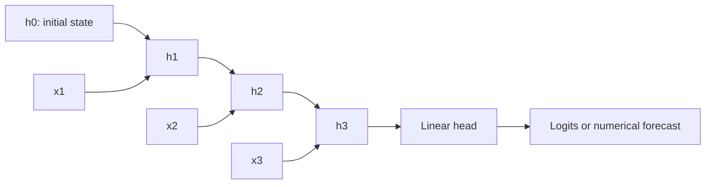

# Documentation Volume 4 — Recurrent Neural Networks

DeepLearningStudio M6 • Python 3.12 / PyTorch • offline, CPU-friendly lessons.

## Sequential learning

A dense layer maps a supplied feature vector to another vector. A CNN shares filters across local neighborhoods, often in images. An RNN shares one state-transition rule across **time**. Its current representation depends on the prefix, making the order of observations meaningful. A CNN can also model sequences with temporal convolutions, and a dense model can consume a flattened fixed-size sequence; recurrence is a particular inductive bias, not the only way to process time.

| Model | Typical input | Shared operation | Context |
|---|---|---|---|
| Dense | [B,I] | Across examples | Supplied features |
| CNN | [B,C,H,W] | Across spatial locations | Local receptive field, growing with depth |
| RNN | [B,T,I] | Across time | Recurrent hidden summary of prefix |

One sequence consists of T ordered vectors with I features. B counts independent examples. Temperature and pressure at a moment form a two-feature vector; five moments form [5,2]. Batching three such histories produces [3,5,2]. Reordering the moments can change the task answer.

## Architecture and recurrence

For a single unidirectional layer, using column vectors:

```text
input contribution     u_t = W_ih x_t       W_ih: [H,I]
recurrent contribution r_t = W_hh h_(t-1)  W_hh: [H,H]
preactivation          z_t = u_t + b_ih + r_t + b_hh
new state              h_t = tanh(z_t)     h_t: [H]
```

ReLU is an alternative supported by nn.RNN. PyTorch stores **two** bias vectors [H], even though their forward contributions can be combined. A row-batched implementation uses `x_t @ W_ih.T` and `h_previous @ W_hh.T`. The default initial hidden state is zero; the cell explorer lets you change it.



All h nodes reuse W_ih, W_hh and both biases. An unrolled diagram displays repeated **uses**, not separate learned cells. In stacked networks, the next layer consumes the lower layer's output at the same time step and its own state from the preceding time.

### A numerical example

Take I=H=1, x=[1,2], W_ih=0.5, W_hh=0.25, b_ih=0.1, b_hh=-0.1, h0=0.

```text
t=1: input=0.5×1=0.5; recurrence=0.25×0=0
     z1=0.5+0.1+0-0.1=0.5; h1=tanh(0.5)=0.462117
t=2: input=0.5×2=1; recurrence=0.25×0.462117=0.115529
     z2=1+0.1+0.115529-0.1=1.115529; h2≈0.806008
```

With reversed x=[2,1], h1=tanh(1)=0.761594 and h2=tanh(0.5+0.25×0.761594)≈0.598238. The same elements and weights give a different summary. With W_hh=0, each state depends only on its own input (the final state still depends on which input is last).

## Hidden states, outputs and heads

`nn.RNN` returns the entire top-layer output and the last hidden state of **every** layer. These are not classification logits until a head transforms them.

| Object | batch_first=True | batch_first=False |
|---|---|---|
| Input | [B,T,I] | [T,B,I] |
| Output sequence | [B,T,H] | [T,B,H] |
| h0 and h_n | [L,B,H] | [L,B,H] |
| Final-state head | [B,C] | [B,C] |
| Sequence head | [B,T,C] | [T,B,C] |

For unpadded unidirectional inputs, `output[:, -1, :] == h_n[-1]` in batch-first mode. In the other layout, use `output[-1]`. With padding, use packed h_n or gather at valid lengths; the tensor's last padded position may occur after the actual sequence ends.

**Many-to-one** selects the last representation and emits a class or forecast vector. **Many-to-many** applies a shared head at every valid step, as in sensor labeling. The builder supports both. The training lab uses many-to-one: horizon K forecasting is a direct [B,K] future vector from a final state, not an autoregressive rollout or a many-to-many target.

### Parameter counts

Each biased recurrent layer has `H×I_l + H×H + 2H` parameters. I_l is I for the first layer and H for subsequent layers. The biased linear head adds `C×H+C`. Disabling biases subtracts 2H per recurrent layer and C for the head. Batch size and length do not affect these counts.

Example I=2, H=3, L=2, C=2: first layer 6+9+6=21; second layer 9+9+6=24; head 6+2=8; total **53**. The architecture page shows each matrix shape and the actual PyTorch parameter count alongside inferred dimensions. Recurrent JSON schema v3 is separate from dense v1 and CNN v2; progress remains v1.

## Offline sequence datasets

The lab uses 60% training, 20% validation and the remainder test. Deterministic local RNGs reproduce data from the seed.

1. **Classification:** sample sequences with label 1 when the first value is less than the last. Reversing the same elements flips the label (ties have probability zero for continuous samples). A permutation-invariant bag representation cannot solve the task, though access to positional first/last features is sufficient; the task does not require remembering every middle element.
2. **Sine forecasting:** independently sample sine source series with varied phase/frequency and configurable noise, sequence length, sample count and horizon. Each example has its own source-series ID, and no source is shared across splits. All future targets from one source remain with that example. There are no overlapping source windows across splits.
3. **Memory:** the sign of the first element determines the label; other positions are distractors. Increasing length increases the gap between the cue and final decision.

All generated values are used directly; there is no fitted scaler. For real time-series data, split chronologically or by source before creating overlapping windows. Fit any learned normalization on training data alone. Randomly splitting overlapping windows can leak nearly identical observations into test data and is inappropriate.

## Training classification and forecasts

```python
model = nn.RNN(input_size=1, hidden_size=12, num_layers=1,
               batch_first=True, nonlinearity='tanh')
head = nn.Linear(12, 2)
output, hidden = model(x)             # x: [B,T,1]
logits = head(hidden[-1])             # [B,2]
loss = nn.CrossEntropyLoss()(logits, labels)  # labels: [B], int64
```

For numerical forecasting, head output width is K and `MSELoss(prediction, target)` consumes matching [B,K] tensors. Classification displays accuracy; forecasting displays MAE in addition to optimized MSE. MAE is in the original generated units.

The training lab configures epochs, batch size, learning rate, hidden width, stacked layers, activation, SGD/Adam and a clipping threshold. Zero disables clipping. It plots training and validation loss/metric, global gradient norms before/after clipping, parameter changes, and one training example's hidden progression. Changing any setting invalidates the previous run and test result, preventing stale predictions from appearing under a new configuration.

Test evaluation is an explicit action after fitting. It displays final held-out loss, accuracy or MAE, example predictions and incorrect labels (or largest regression errors). Validation does not update weights; neither validation nor test data influences generation or preprocessing. Use validation for model selection and reserve test for the final chosen setup. Repeated test-driven tuning turns the test set into another validation set.

## Backpropagation Through Time

Training first unrolls the recurrence, computes loss, calls `backward()`, then applies an optimizer update. For a terminal loss, the gradient to an earlier state follows all intervening recurrent Jacobians:

```text
J_k = diag(f'(z_k)) W_hh
dL/dh_t = (J_(t+1).T ... J_T.T) dL/dh_T
dL/dW_hh = Σ_t (dL/dz_t) h_(t-1).T
SGD: W_new = W_old − learning_rate × dL/dW
```

Vector transpose/order matters; in the scalar demonstration these reduce to ordinary products. Each unrolled use contributes to a single shared W_hh gradient. `retain_grad()` preserves non-leaf state gradients for inspection. `optimizer.zero_grad()` clears accumulated parameter gradients before a new independent update; `backward()` computes them; `step()` changes parameters.

### A controlled gradient example

The explorer sets H=I=1, h0=0.01, every x_t=0.01, input weight 1, no biases, trainable recurrent gain a, and a terminal **diagnostic loss L=h_T**. This linear terminal loss isolates chain products; practical training uses CE/MSE instead. With positive ReLU states, derivatives are exactly one, so `dL/dh_t = a^(T-t)` and `dL/dx_t = a^(T-t)`.

- With a=0.3 and T=12, the first input gradient is `0.3^11 ≈ 0.00000177147`: vanishing.
- With a=1.5 and T=20, it is `1.5^19 ≈ 2216.84`: exploding.
- With Tanh, the additional derivative `1-h_t²` can shrink gradients, especially when activations saturate. Gain >1 does not guarantee explosion under Tanh.

The UI reports the terminal loss, per-state gradient magnitudes, input gradients and each time step's contribution to the shared parameter gradient. Their sum is compared with autograd's gradient before clipping.

### Gradient clipping

For global norm `n=||g||_2` and threshold c, PyTorch approximately rescales by `min(1,c/(n+epsilon))`. The explorer shows the before norm, threshold, after norm and actual SGD arithmetic. The training lab clips the global norm across **all** parameters after backward and before the optimizer step. The diagnostic explorer has one trainable scalar parameter.

Clipping reduces excessively large updates. It does not enlarge tiny gradients, recover vanished signals, restore detached paths, or guarantee convergence. The state-gradient plot shows values before parameter clipping; clipping parameter `.grad` does not retroactively modify retained state gradients.

### Truncated BPTT

Chunk size k detaches the carried state **before zero-based positions k, 2k, …**. For T=12 and k=4, boundaries are before indices 4 and 8. A final-only loss reaches input indices 8..11 and states in the last chunk; earlier input/state gradients are zero or disconnected. The hidden values still carry earlier information forward. The shared parameter receives local contributions from the last chunk; its earlier graph uses cannot receive credit from that terminal loss.

Real streaming training often computes losses and updates per chunk while detaching carried context between chunks. This lightweight demonstration uses one terminal loss to make the truncation boundary unambiguous.

## Variable-length sequences

Padding creates a rectangular batch, but a zero input is still an RNN step: recurrent weights and biases can change its state. Therefore `output[:,-1]` is not a reliable final representation for a shorter example.

```python
lengths = torch.tensor([5, 2, 4])
packed = pack_padded_sequence(x, lengths.cpu(), batch_first=True,
                              enforce_sorted=False)
packed_output, h_n = rnn(packed)
output, _ = pad_packed_sequence(packed_output, batch_first=True)
final_valid = h_n[-1]
mask = torch.arange(x.shape[1])[None, :] < lengths[:, None]
loss = (predictions[mask] - targets[mask]).square().mean()
```

Lengths must be positive integers, one per example, no larger than padded T. Packing can accept unsorted input; PyTorch restores original example order. Output at invalid packed positions is zero-padded on unpacking. Gathering `output[batch_index, lengths-1]` equals the top packed hidden state.

For many-to-many supervision, mask **before computing the loss**, exclude invalid positions from numerator and denominator, and avoid letting NaNs in padding contaminate loss. `masked_mse` is tested with NaNs in padded targets and zero gradients at invalid positions. The M6 training datasets are fixed-length; packing is a separate supporting explorer.

## Platform tutorials

### Inspect one cell

Open Learning Studio → Recurrent Neural Network (RNN) → Cell & unrolling. Start with two features, three hidden units and five steps. Edit input cells, change initial state or activation, and select a step using the slider or Previous/Next buttons. Read matrices on the left and contributions/preactivation/state on the right. Select a hidden unit to inspect scalar arithmetic. For exact weights, enable JSON editing; provide matching matrices and biases. Orange marks the current state, yellow its predecessor; hover over inputs/states for values.

### Build and inspect tensors

Open Sequence tensors or Recurrent architecture. Change B, T, I, H and layer count; compare actual intermediate PyTorch values with inferred rows. Toggle batch_first and final/sequence selection. Inspect weight shapes and export the framework-neutral specification. These builders use seeded demo inputs and do not change the independent training lab settings.

### Train and inspect predictions

Open Sequence datasets to preview a generated training example. In Training laboratory choose classification, Adam, eight epochs and default settings; click Train RNN. Read validation curves before clicking Evaluate RNN held-out test. Then select forecasting and train a new run; inspect the horizon prediction chart and largest errors. A short run verifies the workflow but is not a promise of high accuracy. Larger horizon/noise and longer dependencies may require more data or epochs.

### Learn gradients and padding

In BPTT & clipping compare ReLU gains 0.3 and 1.5. Then lower clipping threshold and set chunk size 4. Explain which gradients disappear versus which are merely scaled. In Variable lengths use 5,2,4 and compare wrong_padded_last with final_valid and packed_hidden.

### Keep progress

Answer the quiz, save experiment notes, mark the lesson complete and export progress JSON. Import accepts existing M4/M5 v1 records and preserves their lesson IDs. Session state alone is temporary and does not synchronize across devices. Browser file-picker/download behavior is a separate manual check from JSON serialization tests.

## Guided experiments and expected observations

The following concept reference repeats the app's authoritative teaching content and guided experiments. It is generated from `learning/rnn_content.py` so formulas, questions and expected answers stay aligned.

### Sequential data

Order carries information. A dense layer treats each supplied vector independently; a CNN learns local spatial patterns; an RNN carries a state from earlier time steps.

Formula: $h_t=f(x_t,h_{t-1})$.

Shapes: [B,T,I] contains B ordered sequences, not B×T independent examples.

Use: Recognize whether a measurement rises or falls.

Experiment: Reverse the cell input rows; compare the last states.

### Time steps and length

One recurrence processes one time step. Longer sequences reuse the same parameters more times.

Formula: $t=1,\ldots,T$.

Shapes: [B,5,I] → [B,10,I] doubles time, not the parameter count.

Use: Compare short and long sensor histories.

Experiment: Increase sequence length while holding seed and weights fixed.

### Input features

Each time step may contain several measurements, such as temperature and pressure.

Formula: $x_t\in\mathbb{R}^{I}$.

Shapes: x_t: [I]; W_ih: [H,I]; W_ih x_t: [H].

Use: Multivariate forecasting.

Experiment: Change input size and inspect the input matrix columns.

### Hidden state

The hidden vector is a learned summary of the prefix. It is compressed and need not retain every detail.

Formula: $h_t=\tanh(z_t)$.

Shapes: [B,H] at each time; full sequence [B,T,H].

Use: Summarize earlier words for classification.

Experiment: Inspect a hidden unit across time in the heatmap.

### Recurrent connections

The previous hidden vector influences the next state through a recurrent matrix.

Formula: $r_t=W_{hh}h_{t-1}$.

Shapes: [H,H] @ [H] → [H].

Use: Retain context between observations.

Experiment: Set W_hh to zero using editable weights and compare states.

### Shared weights

Every unrolled cell is the same transformation. Gradients from each use accumulate in the same parameter.

Formula: $P=HI+H^2+2H$.

Shapes: W_ih [H,I], W_hh [H,H], b_ih [H], b_hh [H].

Use: Handle different lengths with fixed model size.

Experiment: Double T and verify the builder parameter count stays constant.

### Initial hidden state

The first step has no earlier observations. Usually h0 is zero, but an explicit starting context is possible.

Formula: $h_0=0$.

Shapes: For stacked RNNs h0: [L,B,H], regardless of batch_first.

Use: Initialize a new independent sequence.

Experiment: Change initial state from 0 to 1 and inspect its fading effect.

### RNN cell

Add input and recurrent contributions plus two biases, then apply one nonlinearity.

Formula: $h_t=f(W_{ih}x_t+b_{ih}+W_{hh}h_{t-1}+b_{hh})$.

Shapes: [H,I] @ [I] + [H,H] @ [H] + [H] + [H] → [H].

Use: Understand one numerical update.

Experiment: In Cell explorer select a step and sum the displayed contributions.

### Sequence processing

The output of each recurrent step becomes context for the next. Reordering inputs changes this path.

Formula: $h_T=f(x_T,f(x_{T-1},\ldots))$.

Shapes: [T,I] → [T,H] for an unbatched cell trace.

Use: Detect a temporal pattern.

Experiment: Step forward and backward; compare original and reversed order.

### Many-to-one

Select a final representation and predict one label or future vector per sequence.

Formula: $o=W_{out}h_T+b_{out}$.

Shapes: [B,T,H] → [B,H] → [B,C].

Use: Classify first-versus-last order.

Experiment: Choose final output selection in Architecture and trace logits.

### Many-to-many

Apply the same linear head at every time step. A prediction is produced for every valid position.

Formula: $o_t=W_{out}h_t+b_{out}$.

Shapes: [B,T,H] → [B,T,C]; padded positions must be masked in a supervised loss.

Use: Label each sensor sample.

Experiment: Choose sequence output selection and inspect the extra time axis.

### Stacked RNNs

A higher recurrent layer reads the lower layer’s output at the same time and its own previous state.

Formula: $h_t^{(l)}=f(W_{ih}^{(l)}h_t^{(l-1)}+W_{hh}^{(l)}h_{t-1}^{(l)}+b^{(l)})$.

Shapes: First W_ih [H,I]; subsequent W_ih [H,H]; h_n [L,B,H].

Use: Learn hierarchical temporal representations.

Experiment: Change layer count from 1 to 3 and inspect parameter tensors.

### Tanh and ReLU

Tanh bounds states between -1 and 1 but can saturate. ReLU keeps positive values and can grow without a bound.

Formula: $f(z)=\tanh(z)\quad\mathrm{or}\quad\max(0,z)$.

Shapes: Activation preserves [B,H].

Use: Compare stability of recurrence.

Experiment: Use ReLU and recurrent gain 1.5 in BPTT, then switch to Tanh.

### Sequence outputs and final states

nn.RNN returns every top-layer output plus the final hidden state of every layer. Padding changes which time position is valid.

Formula: $output_{:,T-1,:}=h_{n,-1,:,:}$.

Shapes: Equality holds for unpadded unidirectional sequences; output [B,T,H], h_n [L,B,H].

Use: Choose a representation for classification.

Experiment: Compare padded last and final valid states in Variable lengths.

### Loss functions

Classification compares raw logits with integer labels. Forecasting compares numerical values. Neither requires manually applying softmax first.

Formula: $L_{CE}=-\log\mathrm{softmax}(o)_y;\quad L_{MSE}=\mathrm{mean}((o-y)^2)$.

Shapes: CE: [B,C] and [B]; forecast MSE: [B,K] and [B,K].

Use: Train classifiers and sine forecasts.

Experiment: Train both tasks; compare accuracy with MAE instead of conflating metrics.

### Backpropagation Through Time

Autograd follows the unrolled graph backward. Each use of shared weights contributes to their final gradient.

Formula: $\frac{\partial L}{\partial W}=\sum_t\frac{\partial L}{\partial z_t}\frac{\partial z_t}{\partial W}$.

Shapes: Each parameter gradient has exactly its parameter shape.

Use: Learn from a terminal prediction.

Experiment: Run BPTT explorer; inspect early-state gradients before the SGD update.

### Vanishing gradients

Repeated Jacobians with magnitudes below one shrink the learning signal to earlier steps.

Formula: $\frac{\partial h_T}{\partial h_t}=\prod_{k=t+1}^T\mathrm{diag}(f^{\prime}(z_k))W_{hh}$.

Shapes: [H,H] Jacobians multiply across time; the controlled scalar ReLU example gives gain^(T-t).

Use: Understand failure to remember remote information.

Experiment: Set gain 0.3 and ReLU; increase length and inspect earliest gradients.

### Exploding gradients

Repeated amplification can produce enormous gradients and unstable updates. ReLU states can also grow.

Formula: $|\partial h_T/\partial h_t|=|a|^{T-t}$.

Shapes: The scalar controlled demonstration uses H=1 and positive ReLU states.

Use: Diagnose unstable recurrent training.

Experiment: Set gain 1.5, ReLU, length 20; inspect the norm before clipping.

### Gradient clipping

Rescale the complete parameter gradient when its global norm exceeds a threshold. Small gradients are unchanged.

Formula: $g_{clip}=g\min(1,c/(\|g\|_2+\epsilon))$.

Shapes: All gradient tensors keep their shapes; their global norm is bounded by c.

Use: Stabilize large updates.

Experiment: Compare threshold 0.1 and 10; clipping does not restore vanished gradients.

### Truncated BPTT

Detach a carried state at explicit chunk boundaries. Forward context continues, but gradients cannot cross those boundaries.

Formula: $h_{k}=\mathrm{stopgrad}(h_k)$.

Shapes: [B,H] values persist while their prior autograd history is severed.

Use: Bound memory and computation on long streams.

Experiment: Set chunk size 4; final-only loss cannot reach inputs before the last boundary.

### Long-sequence limitations

Fixed state size and repeated Jacobians make long-distance learning difficult. More hidden units do not guarantee memory.

Formula: $h_T\in\mathbb{R}^{H}\quad\mathrm{for\ any}\ T$.

Shapes: T may grow while H stays fixed.

Use: Understand memory bottlenecks.

Experiment: Compare memory-task validation scores at lengths 4 and 30 with other settings fixed.

### Why LSTM, GRU and attention follow

Gates can control state retention; attention can directly access other positions. These motivate future lessons rather than adding those models here.

Formula: $context_t=\sum_s\alpha_{ts}v_s$.

Shapes: Attention can combine [T,H] states instead of relying only on one [H] summary.

Use: Prepare for language and long-context models.

Experiment: Explain which early input your final RNN state might forget, using the heatmap.

## Experiment checklist

- **Increase length from 4 to 16.** Expected: The heatmap grows along time; parameter count stays fixed.
- **Change hidden width from 3 to 6 and predict the count.** Expected: The recurrent H² term grows quadratically; each PyTorch layer has two H biases.
- **Compare Tanh and ReLU with fixed weights.** Expected: Tanh is bounded; positive ReLU recurrence can grow.
- **Reverse the same input elements.** Expected: The final state usually changes; the classification label reverses for first-versus-last.
- **Train memory sequences of lengths 4 and 30.** Expected: Long-distance credit assignment is harder; exact scores depend on the controlled seed/settings.
- **Lower clipping threshold while holding BPTT setup fixed.** Expected: The before norm stays fixed while the after norm and update shrink.
- **Compare classification and forecasting.** Expected: CE learns logits/labels; MSE learns numerical future values; compare accuracy versus MAE.

## Quiz with answers and explanations

1. What makes a sequence task order-sensitive? **Answer: Permuting elements can change the label.** First-versus-last comparison flips when the sequence is reversed.

2. What is a hidden state? **Answer: A learned summary of the prefix.** It carries context through the recurrence.

3. Which matrix carries the previous state? **Answer: W_hh.** W_hh maps H previous hidden features to H current preactivations.

4. Doubling sequence length changes the recurrent parameter count by? **Answer: No change.** All time steps share weights.

5. Batch-first input dimensions are? **Answer: [B,T,I].** Batch, time, input features.

6. Three-layer unidirectional h_n has shape? **Answer: [3,B,H].** h_n contains the final state of each layer.

7. Many-to-one classification head returns? **Answer: [B,C].** Select a final representation before the linear head.

8. Many-to-many applies the head at? **Answer: Every valid time step.** Padded positions must be excluded from loss.

9. BPTT accumulates shared weight gradients from? **Answer: Every connected use across time.** The same parameter contributes repeatedly in the unrolled graph.

10. Small Jacobian products cause? **Answer: Vanishing gradients.** Multiplying small derivatives shrinks early learning signals.

11. Does clipping solve vanishing gradients? **Answer: No.** Clipping only scales down large gradients.

12. Why can vanilla RNNs struggle with long dependencies? **Answer: Repeated Jacobians and a fixed-size state.** Gates and attention motivate later milestones.

13. After detaching at time 8, can final-only loss reach input 2? **Answer: No.** Forward information may survive, but the earlier gradient path is severed.

14. Why avoid a padded last state for classification? **Answer: It may summarize padding after the real sequence ended.** Use packed h_n or gather the valid final output.

## Troubleshooting

- Matrix shape errors: W_ih must be [H,I], W_hh [H,H], each bias [H], input [T,I]. JSON editing must retain these dimensions and finite numeric values.
- Poor accuracy: increase training epochs or inspect the validation curve. The memory task deliberately becomes harder with longer sequences. Use deterministic comparisons and avoid test-driven tuning.
- Diverging loss: lower learning rate, enable clipping and compare Tanh with ReLU. Clipping does not bound hidden activations.
- Unexpected last states: check batch_first, top-layer selection and valid lengths. A padded final position may be wrong.
- Zero early gradients: inspect gain, activation saturation and detach boundaries before interpreting zero as a software bug.
- Missing prior run: any training setting change deliberately invalidates the old run and test result.
- Lost progress: export JSON before ending a session; saved notes in memory alone are temporary.
- Windows pytest temporary-directory errors: use the ordinary project terminal with appropriate temporary-directory access. Do not disable ONNX tests to conceal fixture failures.

## Implementation and verification map

`learning/rnn_spec.py` owns framework-neutral schema/shape/count rules; `rnn_adapter.py` owns PyTorch execution, tracing, cell arithmetic, BPTT and packing; `rnn_training.py` owns generated data, splits and fitting; `rnn_content.py` owns teaching metadata; `rnn_ui.py` owns Streamlit presentation; `visualization/rnn_graphs.py` owns reusable figures. Tests live in `tests/test_rnn.py` and `tests/test_rnn_ui.py` alongside unchanged legacy suites. Milestone requirements, design, acceptance evidence and verification limits live under `docs/milestones/M6_*`.

## Looking ahead to LSTM

Vanilla RNNs compress a prefix into H values and repeatedly multiply recurrent Jacobians. LSTM and GRU introduce learned gates to manage state retention; attention can access representations at other positions directly. M6 prepares sequence tensors, packing, shared visualizations and progress infrastructure for those lessons. It does not implement their full architectures or promise that wider vanilla RNNs solve every long-distance dependency.
