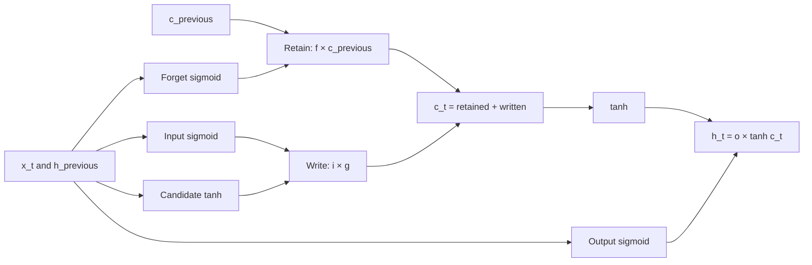
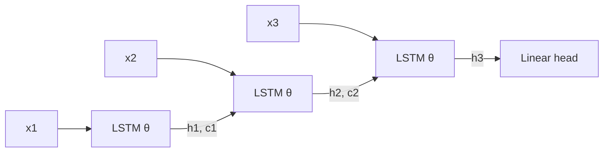

# Documentation Volume 5 — Long Short-Term Memory Networks

DeepLearningStudio M7. Read [Volume 4](VOLUME_4_RNN.md) first for recurrent
sequences, shared weights, BPTT and padding. Open **Learning Studio → Long
Short-Term Memory (LSTM)** to run the examples below. All explorers execute
PyTorch tensors; plots reflect those values. No dataset download is required.

## 1. Why gated memory?

A vanilla RNN computes $h_t=\tanh(W_xx_t+W_hh_{t-1}+b)$.
Its training signal must traverse repeated Jacobians. A scalar factor of 0.5
across ten transitions produces $0.5^{10}=0.0009766$; a factor of 1.5 produces
$57.665$. Tanh saturation can shrink gradients further. A model might need to
remember an early symbol through many unrelated distractors to classify a
sequence at its final step. The most recent observation alone cannot solve it.

LSTM adds an internal cell state $c_t$ and learned gates that regulate retention,
writing and exposure. The hidden state $h_t$ is the exposed representation used
by the next step's gate functions and by prediction heads. Both states propagate
through time. They have equal dimensions, but their values generally differ.

An LSTM mitigates long-range gradient problems; it does not guarantee permanent
memory, successful optimization or better accuracy than an RNN on every task.

## 2. Cell architecture and equations

For an unbatched step, $x_t\in\mathbb R^I$ and
$h_{t-1},c_{t-1}\in\mathbb R^H$. Each $W_{i*}$ has shape $[H,I]$,
each $W_{h*}$ has shape $[H,H]$, and each bias/gate has shape $[H]$.
The symbol $\odot$ means element-wise multiplication.

$$
\begin{aligned}
f_t&=\sigma(W_{if}x_t+b_{if}+W_{hf}h_{t-1}+b_{hf})\\
i_t&=\sigma(W_{ii}x_t+b_{ii}+W_{hi}h_{t-1}+b_{hi})\\
g_t&=\tanh(W_{ig}x_t+b_{ig}+W_{hg}h_{t-1}+b_{hg})\\
o_t&=\sigma(W_{io}x_t+b_{io}+W_{ho}h_{t-1}+b_{ho})\\
c_t&=f_t\odot c_{t-1}+i_t\odot g_t\\
h_t&=o_t\odot\tanh(c_t).
\end{aligned}
$$

Sigmoid $\sigma(z)=1/(1+e^{-z})$ produces values between zero and one.
Tanh produces signed values between -1 and 1. The candidate $g_t$ proposes
content; it is not a sigmoid gate. Forget values near zero suppress old memory;
values near one retain more of it. The input gate controls the candidate write.
The output gate exposes transformed memory without directly erasing $c_t$.
Normal gates are learned functions of inputs and previous hidden states, rather
than fixed switches or user-selected constants.



### Worked scalar example

Choose $I=H=1$, $x_t=1$, $h_{t-1}=0$, $c_{t-1}=0.5$, and zero biases.
Set packed input weights to $[0,\log 4,\operatorname{atanh}(0.3),\log(7/3)]^T$
and recurrent weights to zero. Then:

| Transform | Preactivation | Activation |
|---|---:|---:|
| Input | 0 | 0.5 |
| Forget | 1.386294 | 0.8 |
| Candidate | 0.309520 | 0.3 |
| Output | 0.847298 | 0.7 |

The old contribution is $0.8\times0.5=0.4$, and the write is
$0.5\times0.3=0.15$. Thus $c_t=0.55$ and
$h_t=0.7\tanh(0.55)\approx0.350364$. Cell memory is not the exposed hidden state.
With $H>1$, do the same arithmetic independently per unit after the matrix
products. The matrix products mix input features and previous hidden units.

In **Cell & unrolling**, choose $I=H=1$ and two steps, edit the first input to 1,
set the initial cell to 0.5, enable JSON editing and enter these packed weights.
Inspect every linear contribution, bias, activation, retained/write term, and
selected-unit calculation. Previous/Next navigates the actual computed sequence.
JSON can also set distinct initial values per unit; changing dimensions requires
matching packed matrices and vectors. Invalid shapes/nonfinite values are rejected.

## 3. PyTorch packing and parameter counts

PyTorch packs gates in **input, forget, candidate, output** order, abbreviated
**i,f,g,o**. This differs from teaching presentations that start with the forget
gate. For hidden width $H$, use row slices $[0:H]$, $[H:2H]$, $[2H:3H]$,
$[3H:4H]$. The explorer uses exactly this mapping.

| Tensor | Shape | Interpretation |
|---|---|---|
| weight_ih_l0 | [4H,I] | Four input transforms |
| weight_hh_l0 | [4H,H] | Four previous-hidden transforms |
| bias_ih_l0 | [4H] | Input-side bias group |
| bias_hh_l0 | [4H] | Recurrent-side bias group |

PyTorch stores two separately trainable bias groups. Their forward contributions
add, but both count as parameters. For one unidirectional biased layer:

$$P=4HI+4H^2+8H.$$

For $I=2,H=3$, this is $24+36+24=84$. A second layer reads width $H=3$,
so adds $36+36+24=96$. A two-class biased linear head adds $CH+C=8$:
one layer total 92; two layers total 188. With biases disabled, subtract $8H$
per recurrent layer and $C$ from the head. A vanilla RNN with the same widths
has $HI+H^2+2H=21$ recurrent parameters: one quarter as many in this example.
Prediction heads add the same count in both models. Batch size and sequence
length change activation/compute costs, not trainable parameter counts.

## 4. Sequences, layouts and stacked layers

For batch size $B$, time length $T$, input width $I$, hidden width $H$ and $L$ layers:

| Quantity | batch_first=True | batch_first=False |
|---|---|---|
| Input | [B,T,I] | [T,B,I] |
| Full top-layer output | [B,T,H] | [T,B,H] |
| Final hidden h_n | [L,B,H] | [L,B,H] |
| Final cell c_n | [L,B,H] | [L,B,H] |
| Final-state head | [B,C] | [B,C] |
| Sequence head | [B,T,C] | [T,B,C] |

The full output holds the top layer's hidden representation at every time step.
Final states collect each layer's last hidden and cell state. Final prediction
uses $h_n[-1]$; $c_n$ is not a second prediction tensor. Sequence selection
applies the linear head at every position. This is a per-step head, not an
autoregressive encoder/decoder. The training lab uses final-state heads only.



The same parameters θ operate at each step. Different stacked layers have
different parameters; layer 2 reads layer 1 outputs, each of width $H$.
Optional dropout operates between layers during training and needs at least
two layers. Architecture traces run in evaluation mode, so dropout is inactive.

In **LSTM architecture**, change layers, width, batch/time layout and final versus
sequence selection. Read inferred shapes beside actual tensors and parameter
shapes. The head input width is inferred. Inspect the selected gate's matrices.
Export JSON as LSTM schema v4; old dense v1, CNN v2, RNN v3 and progress v1 stay
unchanged. See [ADR-0003](adr/ADR-0003-framework-neutral-lstm.md).

## 5. Retaining, writing and exposing memory

**Gate & state laboratory** deliberately replaces learned gates with fixed
interventions, clearly labelled in the UI. A known scalar sequence contains
+1 first, -0.5 at the middle, and zeros elsewhere, with candidate $\tanh(x_t)$.
The initial memory is configurable. Reverse the order and change the duration.
Synchronized plots show inputs, all gate values, $c_t$ and $h_t$.

Try these controlled interventions:

1. Set input gate to 0. Old memory decays as $c_T=f^Tc_0$.
2. Compare forget values 0.05 and 0.99 over 5 and 40 steps. The first erases
   memory quickly; the second retains more, but still decays.
3. Set input gate to 1. Candidate content now writes at full strength.
4. Set output gate to 0. Hidden output vanishes while cell memory remains.
5. Reverse inputs. The negative write arrives at a different time and is retained
   for a different duration, changing the final state.

Even $0.99^{100}\approx0.366$. Cell states can accumulate through writes, and
their magnitude is not bounded to [-1,1]. Hidden states are bounded by tanh
and the output gate. Real gates can vary per time step and unit; the controlled
constant-gate demonstration is an intervention, not a trained model claim.

## 6. BPTT through both states

For the direct cell pathway with gates held fixed:

$$\left.\frac{\partial c_T}{\partial c_t}\right|_{direct}
=\operatorname{diag}\left(\prod_{k=t+1}^{T}f_k\right).$$

This expression describes one path. The full derivative also includes paths
through hidden states, gate functions and later predictions. Gates depend on
$h_{t-1}$, which depends on earlier memory. Do not treat the forget product as
the complete LSTM gradient. With controlled constant gates and terminal loss
$L=c_T$, the lab isolates this path; its autograd and analytical curves agree.

**BPTT & clipping** instead unrolls a real two-unit LSTM, retains gradients on
each cell and hidden tensor, predicts by summing terminal hidden units, and
uses scalar regression target 1: $L=(\hat y-1)^2$. It executes:

```python
optimizer.zero_grad()
# explicit gate/state recurrence; retain_grad on intermediate h and c
loss.backward()
torch.nn.utils.clip_grad_norm_(parameters, threshold)
optimizer.step()
```

Inspect input gradients over time, state gradient norms, input/recurrent weight
gradients and each gate slice. The plots show pre-clipping state gradients.
Parameter tensors display before values, raw gradients, clipped gradients and
actual after values. Loss is recomputed after the update; a decrease is not
guaranteed for every setting.

Plain SGD here has no momentum/decay: $\theta'=\theta-\eta g_{clipped}$.
Adam uses bias-corrected exponential first and second moments:
$\theta'=\theta-\eta\hat m/(\sqrt{\hat v}+\epsilon)$.
The UI uses the appropriate equation and actual optimizer results. A small
clipping threshold scales large global parameter gradients to the limit;
it does not restore vanished gradients. Change forget bias, weight scale
and sequence length to inspect saturation and difficult memory propagation.

## 7. Offline sequence training

**Training laboratory** has two tasks. All splits are deterministic, 60% train,
20% validation and the remainder test. No fitted preprocessing is needed.

**Memory classification:** the target is a randomly drawn class 0/1. At position
$T-1-d$, insert a noisy sign signal $2y-1+\epsilon$. All other positions are
independently drawn distractors, and the terminal head must recall the signal
across distance $d$. Distance is between 1 and $T-1$. No target is inserted
into the final observation, and distractors do not depend on the label.
This is a controlled recall task rather than a realistic text benchmark.

**Forecasting:** each sample is an independently phased/frequency sine source
with optional noise. A history window predicts the next $K$ values directly.
Source IDs are disjoint across splits: overlapping windows from one source
cannot leak into another split. No external data or train/test scaling leakage.
This evaluates generalization to independent synthetic series, rather than
chronological extrapolation on a single real-world series.

Choose samples, length, dependency distance, noise, seed, hidden width, layers,
dropout, epochs, batches, learning rate, SGD/Adam and clipping. Classification
uses raw logits and CrossEntropyLoss with integer targets; regression uses
MSELoss. A zero clipping threshold disables clipping. Model initialization,
batch order and dropout are reproducible for a fixed configuration/environment.
Changing controls invalidates stale training/test results.

Press **Train LSTM**. Read train/validation loss, accuracy or MAE, parameter
count, update norms, gradient norms and validation examples/mistakes. These
are actual optimization results. Press **Evaluate held-out test** only when
ready; fitting never evaluates the test split. Repeated tuning against test
results compromises the held-out interpretation. Tiny smoke tests do not
establish statistically reliable learning quality.

## 8. RNN versus LSTM

**RNN versus LSTM** reuses the M6 RNN and trains both models on the same data
objects, splits, batches, epochs, optimizer, rate, widths and layers. The RNN
uses tanh. Optional inter-layer dropout is LSTM-only and explicitly reported;
use zero dropout for the closest matching experiment. Equal hidden width is
not equal parameter capacity. LSTM computes four transforms per step and
carries two states; training time and counts are displayed alongside metrics.

Compare measured loss curves, gradient norms, predictions, incorrect labels
and explicit test metrics. **Measure dependency distances** retrains both at
short, middle and long distances and reports validation accuracy, parameters
and duration. These results are measured when requested, never fabricated or
pre-filled. Seeds and budgets can change rankings. A single run cannot establish
general superiority; compare several seeds and consider matched parameter budgets
outside this equal-width educational experiment.

## 9. Variable lengths, padding and masks

**Variable lengths** starts with lengths 5,2,4. Zero-padding makes a rectangular
batch, but ordinary LSTM execution still updates gates and both states on
zero inputs. The last padded position can differ from the final valid state.

```python
packed = pack_padded_sequence(x, lengths.cpu(), batch_first=True,
                              enforce_sorted=False)
packed_output, (h_n, c_n) = lstm(packed)
output, lengths = pad_packed_sequence(packed_output, batch_first=True)
final_valid_hidden = h_n[-1]
```

Packed execution skips padding. Both final states use $[L,B,H]$. The gathered
last valid top-layer output equals $h_n[-1]$, including unsorted lengths.
$c_n$ is separately checked against individually executed unpadded sequences.
For per-step supervision, form $mask_{bt}=(t<length_b)$ and compute loss only
over valid positions and features; padding contributes neither numerator nor
denominator. Tests poison padding with huge inputs and NaN targets and verify
unchanged packed states and zero padded-target gradients. The training lab uses
fixed-length samples; variable-length task training is outside this lesson.

## 10. Guided tutorial and quiz explanations

Work through Concepts, Cell, Gates, Architecture, Training, Comparison, BPTT,
Variable lengths, then Quiz. Save notes and mark the lesson complete. Export
progress JSON to retain it after the session; earlier lessons remain intact.
Specifications and progress files are different formats and are not interchangeable.

| Quiz topic | Answer and reason |
|---|---|
| RNN versus LSTM | LSTM adds a separately gated cell-memory pathway. |
| Hidden versus cell | Generally unequal: h=o*tanh(c). |
| Retaining memory | Forget gate multiplies previous c. |
| Writing memory | Input gate multiplies candidate g. |
| Exposing memory | Output gate multiplies tanh(c). |
| Candidate activation | Tanh allows signed content. |
| Sigmoid range | Between zero and one; fractional gates. |
| Tanh range | Between -1 and 1. |
| I=2,H=3 biased count | 84 recurrent parameters, excluding the head. |
| Final cell shape | [layers,batch,hidden], independent of batch_first. |
| Long-range task | Recall an early symbol after independent distractors. |
| Direct cell derivative | Forget product along this path; other paths contribute. |
| Retention guarantee | None: 0.99 raised to a large duration decays. |
| Guaranteed superiority | None: judge measured experiments. |
| Clipping vanishing gradients | Clipping controls explosion, not vanishing. |

## 11. Troubleshooting and limits

- Invalid JSON: use numeric arrays with matching [4H,I], [4H,H], [4H], [H]
  shapes, finite values and quoted keys. Restore defaults by disabling editing.
- Dropout validation: nonzero dropout needs at least two layers; it affects
  training only, so eval traces are deterministic.
- Weak learning: inspect validation loss, distance, noise, initialization and
  budget; lower learning rate or enable clipping for divergence. Do not demand
  a quality threshold from one-epoch smoke data.
- Missing prior run: configuration changes deliberately clear stale results.
- Different state shapes: batch_first never changes [L,B,H] final states.
- Strange padded predictions: use packed final states and masked per-step losses.
- Progress disappears on restart: export JSON and import it in the next session.

The builder is unidirectional, with no projection/bidirectionality or recurrent
ONNX export. It supports per-step linear outputs but no autoregressive decoder.
No GRU internals, embeddings, attention or Transformer implementation is included.
Fixed-width recurrent memory can bottleneck distant information and execution
is sequential over time. Attention is motivated by direct access to earlier
representations, a subject for a future milestone.

For actual test and delivery evidence, read [M7 completion](milestones/M7_COMPLETION_REPORT.md)
and [handoff](milestones/M7_HANDOFF.md). They distinguish automated/runtime checks
from browser visual checks and independent acceptance review.
