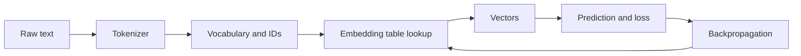
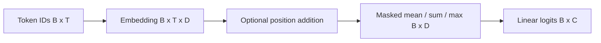

# Documentation Volume 6 — Embeddings and Representation Learning

DeepLearningStudio M8 · Learning Studio → **Embedding Network**.
All labs execute offline on CPU using actual PyTorch tensors. No pretrained
language model, vector database or tokenizer download is needed. M4–M7 lessons
and progress JSON remain available. Attention and Transformers are later lessons.

## 1. Why embeddings?

A model cannot multiply the category name `cat` by a weight matrix. We first
choose tokens, assign categorical integer IDs, and look up real-valued rows.
ID 3 is not inherently closer to ID 4 than to ID 20. IDs can be renamed if table
rows are permuted consistently. Learned coordinates, rather than ID arithmetic,
carry the representation used by downstream computation.



This also applies to item IDs in recommendations, categorical features, and image
patch identities in suitable architectures. An embedding is not automatically a
semantic representation: its usefulness depends on data, objective and evaluation.

## 2. Tokenization, vocabulary and special tokens

The **Tokenization & vocabulary** lab separates text processing from embedding
computation. Word mode lowercases and splits on whitespace; punctuation stays
attached. `Cat dog!` becomes `cat`, `dog!`. Character mode lowercases and retains
each character, including spaces. `A b` becomes `a`, space, `b`.

Fit the vocabulary on the toy corpus or your small custom corpus, one sentence
per line. Ordinary tokens receive contiguous IDs in sorted order. PAD is 0 and
UNK is 1. Corpus frequencies are shown alongside every ID; special tokens may
have zero corpus count. Empty corpora still have the two reserved entries.

With vocabulary `{PAD:0, UNK:1, cat:2, dog:3}`, the tokens `cat mystery` become
`[2,1]`. A padded length of 4 gives `[2,1,0,0]`. A length of 1 truncates to `[2]`.
The mask is `IDs != 0`. UNK is a valid non-padding input and counts in pooling.
Padding is a batching convention, rather than a statement about sentence meaning.

Tutorial:

1. Enter `cat dog mystery`, choose word mode and the toy corpus.
2. Inspect raw text, tokens, vocabulary, unknowns and IDs.
3. Set length to 8 and inspect the PAD positions and zero initial PAD vectors.
4. Switch to character mode; spaces become tokens and sequence length changes.
5. Choose a custom corpus containing no `mystery`; verify UNK handling.
6. Clear the input; the lab remains usable and displays a padded sequence.

Characters generally improve coverage of strings but create longer sequences.
Whole words can create very large vocabularies and OOV problems. Real LLMs often
use subwords to balance coverage, vocabulary size and sequence length. This lab
does not implement production subword tokenization or BPE.

## 3. One-hot representations and embedding tables

For vocabulary size V and embedding width D:

$$x\in\mathbb R^V,\quad E\in\mathbb R^{V\times D},\quad e=xE\in\mathbb R^D.$$

Take

$$E=\begin{bmatrix}0&0\\1&2\\3&4\end{bmatrix},\quad x=[0,0,1].$$

Then `x @ E = [3,4] = E[2]`. A one-hot vector selects exactly one row. PyTorch
`nn.Embedding` performs direct row lookup without constructing the one-hot vector.

```python
import torch
from torch import nn

table = nn.Embedding(3, 2, padding_idx=0)
with torch.no_grad():
    table.weight.copy_(torch.tensor([[0.,0.], [1.,2.], [3.,4.]]))
ids = torch.tensor([[2,1,2,0]])       # [B=1,T=4]
vectors = table(ids)                 # [1,4,D=2]
one_hot = torch.nn.functional.one_hot(ids, 3).float()
torch.testing.assert_close(vectors, one_hot @ table.weight)
```

Parameters are `V × D`, including the allocated PAD row. For V=100,D=8,
the float32 table takes 3200 bytes. One dense float32 one-hot token would take
400 bytes and one dense embedding vector 32 bytes; an int64 token ID takes
8 bytes. Sparse one-hot storage need not store V floats. These quantities describe
different things: input IDs, materialized token vectors and full model parameters.
Dense embeddings do not universally use less total storage than sparse IDs.

**Matrix & one-hot tutorial:** change V, D, seed, initialization and padding index;
select a row; enter repeated IDs; inspect matrix, one-hot tensor and multiplication.
The displayed maximum error verifies agreement. Enable custom JSON to enter a
finite `[V,D]` matrix; malformed or wrong-sized values produce an input warning.
Initialization can be normal, uniform or zero. Random coordinates have no semantic
guarantee. Changing D changes width and count; changing T adds outputs, not weights.

For IDs `[B,T]`, output is `[B,T,D]`. Repeated occurrences of one ID return the same
row in the same table, including when neighboring tokens differ. That is static
lookup, with no contextual mixing.

## 4. Learning through lookup

**Gradients & updates** executes the following deterministic graph:

```text
IDs [1,4] = [[2,2,3,0]]
→ Embedding [1,4,3]
→ Masked mean [1,3]
→ Linear logits [1,2]
→ CrossEntropyLoss with target class 1
```

The lab displays initial table, input IDs, occurrence vectors, prediction, target,
loss, gradients, update and recomputed loss. The same model supplies all stages.

```python
optimizer.zero_grad()
logits = model(ids)
loss = torch.nn.functional.cross_entropy(logits, target)
loss.backward()
optimizer.step()
```

With plain SGD and no momentum/weight decay:

$$E_{new}=E_{old}-\eta\nabla_E L.$$

For old row `[1,2]`, gradient `[0.2,-0.1]`, and rate 0.5, the new row is
`[0.9,2.05]`. Row 2 in the live example accumulates gradients from both occurrences.
Row 3 receives one contribution; row 0 and unused rows receive zero table gradient.
The numerical derivative uses the central difference

$$g_{20}\approx\frac{L(E+\epsilon\Delta_{20})-L(E-\epsilon\Delta_{20})}{2\epsilon},
\quad\epsilon=10^{-5}.$$

The double-precision calculation is displayed against autograd. Switch to Adam:
updates use bias-corrected first/second moments, not simply `rate × gradient`.
Learning rates need not make loss decrease on every possible model update.

`padding_idx` excludes that row's lookup gradient; it does not force a custom
nonzero padding row back to zero. Mask padding when pooling. Optimizer weight
decay, momentum history or weight tying can complicate unused-row behavior beyond
this deliberately simple demonstration. `nn.Embedding(..., sparse=True)` is an
implementation option; sparse gradients store touched indices/values. Ordinary
Adam does not support them; use compatible configurations such as SparseAdam or
supported SGD. The live experiments use dense gradients.

## 5. Similarity, normalization and retrieval

The **Similarity & retrieval** lab supports editable finite vectors:

$$\mathrm{dot}(a,b)=\sum_i a_i b_i$$
$$\cos(a,b)=\frac{a^Tb}{\|a\|_2\|b\|_2}$$
$$d_2(a,b)=\sqrt{\sum_i(a_i-b_i)^2},\quad d_1(a,b)=\sum_i|a_i-b_i|.$$

For `a=[1,0]`, `b=[10,10]`, dot=10, cosine≈0.707107,
Euclidean≈13.453624 and Manhattan=19. Scaling b changes dot and distances;
positive scaling does not change its nonzero cosine. `[3,4]` normalizes to
`[0.6,0.8]`. Cosine is mathematically undefined at zero; the lab explicitly uses
0 as a safe convention, and normalization leaves zero vectors zero.

Tutorial:

1. Start with random toy vectors and inspect the source warning.
2. Choose tokens A/B, edit vector JSON and optionally normalize.
3. Inspect norms, all four metrics and the vector heatmap.
4. Choose a query token, cosine or dot, normalization and Top K.
5. Inspect ranked original-space scores and the full cosine matrix.
6. After training skip-gram, select its trained vectors and repeat.

Higher cosine/dot values generally indicate better matches under the relevant
embedding assumptions; smaller distances indicate closer vectors. Query `[1,0]`
ranks `[10,10]` above `[1,0]` by raw dot, but below it by cosine. For nonzero
normalized vectors, dot equals cosine. Ties use stable input order. Retrieval
excludes the query itself and PAD/UNK.

Exact search scores every candidate: `query [D] @ candidates.T [D,N] → [N]`.
Approximate indexes avoid exhaustive scoring at large scale with a speed/recall
tradeoff. Query and document vectors need compatible models, dimensions and
training conventions; merely matching dimensions does not establish compatibility.
This tiny exact retrieval experiment is not a complete semantic search or RAG
system. Untrained neighbors do not demonstrate semantics.

## 6. Skip-gram with negative sampling

The **Word embedding training** lab uses repeated offline co-occurrence sentences
about pets, fruit and travel. These categories describe the corpus; coordinates
and neighbors are learned, never hardcoded. Input table V and output/context table
U both have shape `[vocabulary_size,D]` and are separate trainable parameters.
Total table parameters are `2 × vocabulary_size × D`.

For the target/context pair `(w,c)` and K negative contexts:

$$L=-\log\sigma(v_w^Tu_c)-\sum_{k=1}^K\log\sigma(-v_w^Tu_{n_k}).$$

Positive pairs come from neighboring positions within the context window, without
crossing sentence boundaries. With `cat dog pet`, window 1, the target dog pairs
with cat and pet; cat pairs only with dog. If all scores are zero and K=2,
loss is `3 log(2) ≈ 2.079442`.

The implementation uses `F.logsigmoid`, which stays stable for extreme scores.
Uniform negatives exclude PAD, UNK, the target and every known positive context
for that target. Sampling is seeded and permits repeated eligible negatives.
An empty eligible set raises a useful error rather than looping indefinitely.
This is a transparent educational variant, not a production word2vec replica
with frequency-smoothed negatives, subsampling and extensive corpus processing.

Tutorial:

1. Set dimension, context window, negatives, rate, batch size, epochs and seed.
2. Choose SGD or Adam and explicitly train.
3. Inspect target/context pairs, actual sampled negatives and parameter count.
4. Read sampled training loss and the fixed-negative objective. The latter uses
   one reproducible negative set at epoch ends for a more comparable objective.
5. Inspect initial/trained input tables, trained context table and changes.
6. Select a word and compare initial/trained cosine neighbors.
7. Change projection axes/method; inspect coordinate tables and neighbor links.
8. Change a training control: results are invalidated until retraining.

Falling loss establishes optimization of this objective, not human semantic
quality. Co-occurrence neighborhoods can differ from intuition. Rare words and
multiple senses remain poorly represented in this small static vocabulary.

## 7. Embedding-space visualization

Plotly supports direct 2D and direct 3D when embedding width matches plot width.
Use PCA for wider vectors. PCA centers points and projects onto maximal-variance
axes; it does not preserve every pairwise distance or guarantee semantic axes.
t-SNE is optional, uses a fixed seed and valid perplexity smaller than sample
count, and is rejected for too few samples. It emphasizes local neighborhoods and
can distort global distances, cluster sizes and between-cluster separations.

The lab jointly projects initial and trained rows to share a coordinate system.
Token labels, coordinate tables, selected-token highlighting and neighbor links
are displayed. Neighbor ranking is always computed in the original embedding
space; links do not assert that projected distances are faithful. PAD/UNK are
excluded from word plots. Changing seed changes initialization and training, and
coordinates may rotate even when some similarity relationships remain stable.

## 8. Sentence pooling

The **Sentence pooling** lab combines random or trained word rows into a fixed
vector `[D]`. For a valid-token mask m:

$$s_{sum}=\sum_t m_te_t,\qquad
s_{mean}=\frac{\sum_tm_te_t}{\max(1,\sum_tm_t)},\qquad
s_{max,d}=\max_{t:m_t=1}e_{td}.$$

With `[1,2]`, `[3,4]` and PAD, masked mean is `[2,3]`, sum `[4,6]`, max `[3,4]`.
Max uses only valid tokens, including when all valid values are negative. Empty
or all-padding inputs return zero for every pooling operation, with no NaNs.

Enter A=`cat dog pet` and B=`pet dog cat`, then try each pooling strategy.
Token IDs and individual vectors differ by order, but pooled outputs agree.
Try an empty sentence, all unseen words and a short truncated length. Padding is
ignored and UNK is included. Word order is lost by these commutative operations.
Simple pooling does not create a contextual sentence encoder, and learned
skip-gram averages are not a substitute for a validated sentence embedding model.

## 9. Position and context

The **Positions & context** lab adds equal-width position and token vectors:

$$z_t=e_{w_t}+p_t.$$

For `[1,2]+[0.1,0.2]`, combined input is `[1.1,2.2]`. Learned positions use an
actual `nn.Embedding(max_length,D)` indexed by position, and add `max_length×D`
parameters. These vectors start random in this explorer; no claim that they have
learned positional meaning is made. Positions beyond capacity are rejected.

Fixed sinusoidal encodings use:

$$PE_{p,2i}=\sin\left(p/10000^{2i/D}\right),\qquad
PE_{p,2i+1}=\cos\left(p/10000^{2i/D}\right).$$

For p=0,D=3: `[0,1,0]`. With odd D, the last even coordinate keeps its sine;
only existing odd coordinates receive cosines. The lab supports D=1 as well.
No positional parameters are learned for this mode.

Tutorial: enter a sentence, adjust length and width, choose learned or sinusoidal
positions, inspect IDs and the three heatmaps, compare two positions, then reverse
token order. Combined per-position vectors change. This introduces position-
dependent inputs, but does not mix information across words. In particular,
mean/sum of token-plus-position vectors over a fixed set of valid positions can
remain invariant to token permutation. A later encoder must use positions and
interactions to model order, rather than merely sum everything away.

Static/contextual example: `The weather is cool.` versus `That movie is cool.`
contains different meanings of cool. The whitespace tokenizer retains punctuation,
so the selected token here is `cool.`. Its static table row is identical in both
sentences; edit either sentence to check the shared lookup. A contextual encoder
can produce different vectors from surrounding words. Position-dependent input
is not the same as full contextual encoding. Attention, multi-head attention and
Transformer computation are deliberately outside M8.

## 10. Architecture builder and framework-neutral schema

**Architecture builder** executes and inspects:



Configure V, D, C, B, T, padding, pooling, position mode, maximum length and seed.
The graph and stage table infer shapes; parameter tables use actual weights.
The logits are raw class scores, suitable for CrossEntropyLoss rather than an
extra softmax before loss. PAD positions are masked after optional position
addition. A fully padded sentence pools to zero and therefore produces head biases.

Parameter count is `VD + CD + C`, plus `max_length×D` for learned positions.
For V=10,D=4,C=2: `40+8+2=50`. Learned positions of capacity 12 add 48;
sinusoidal positions add zero. Export the versioned JSON definition to inspect
its explicit architecture identity and configuration.

`learning/embedding_spec.py` has no PyTorch imports. Dedicated schema v5 coexists
with dense v1, CNN v2, RNN v3 and LSTM v4 without changing their formats.
`EmbeddingAdapter` owns PyTorch execution. The builder and independent training
labs do not silently share model weights. See ADR-0004 for the bounded design.

## 11. Downstream classification

**Classification laboratory** trains embeddings jointly with a classifier on
unique offline adjective/noun sentences. Records are split before vocabulary
fitting: 64 train, 17 validation, 17 test. Validation and test each contain one
deliberately novel token. Only training text fits vocabulary. There are no
duplicate raw sentences across splits; splits share linguistic categories by
design, so this is a simple in-distribution task plus two OOV examples.

Architecture: `[B,T] → Embedding [B,T,D] → masked mean [B,D] → Linear [B,2]`.
Targets are class IDs `[B]`; loss is CrossEntropyLoss. Mini-batch order, model
initialization and split order are seeded. Choose SGD/Adam, D, batch, rate, epochs
and seed. No test predictions or metrics are calculated during training.

Tutorial:

1. Train with the default small budget; inspect train/validation loss and accuracy.
2. Inspect train-only vocabulary, initial/trained rows and last-batch gradients.
3. Use validation for development decisions, then click explicit held-out evaluation.
4. Inspect test cross-entropy, accuracy, confusion matrix and every sample prediction.
5. The confusion matrix rows are true class and columns predicted class.
6. Change a training control; stale model and test metrics disappear.

Changing test labels in tests leaves training bit-identical, confirming that
training does not read the final split. Do not repeatedly tune on final test
results. These tiny generated sentiment examples do not establish language-wide
classification quality, fairness or robustness.

## 12. Evaluation and guided experiments

**Evaluation & experiments** collects interpretation guidance, completed word
plots, any explicitly obtained test accuracy, and these practice tasks:

| Experiment | Expected observation and explanation |
|---|---|
| Double V, fixed D | Table parameters double; IDs remain categorical |
| Double D, fixed V | Wider vectors and twice the table weights |
| Compare one-hot and direct lookup | Numerical equality, repeated ID equality |
| Inspect repeated token gradients | Occurrence contributions accumulate in one row |
| Scale a nonzero vector | Dot changes, cosine direction stays fixed |
| Normalize retrieval vectors | Dot and cosine rankings agree aside from ties |
| Train D=2 then D=8 | Different capacities and plots; no automatic quality gain |
| Reverse pooled tokens | Identical mean/sum/max for the same token multiset |
| Add positions and reverse | Per-position inputs change, without contextual mixing |
| Compare initial/trained neighbors | Co-occurrence rankings change, not guaranteed semantics |
| Repeat another seed with same budget | Measure neighbor stability rather than raw coordinate identity |
| Inspect held-out classifier metrics | Task-specific evidence with train-only vocabulary |

Loss behavior, neighbor inspection, original-space retrieval ranking, visualization,
seed sensitivity and held-out classification each answer different questions.
Never infer semantic quality solely from training loss or an attractive plot.
Small/biased corpora, rare tokens, OOV text, polysemy, language coverage, domain
shift and dimensionality tradeoffs all limit learned representations. Vector
analogies such as `king - man + woman ≈ queen` are patterns seen in some trained
spaces, not laws guaranteed by embeddings. No expected analogy is hardcoded here.

## 13. Quizzes and progress

**Quiz & progress** has 21 questions. Answer every question, grade, read the
explanations, save experiment notes, mark completion and export progress JSON.
The existing progress schema v1 preserves earlier lessons, scores and notes.
Importing a file restores its record; export a current copy before replacing it
with an older record. Progress lives in session memory until exported.

Answer explanations:

1. Tokenization produces a sequence of tokens before lookup.
2. IDs are categorical identities, not semantic quantities.
3. Unseen vocabulary entries map to UNK.
4. One-hot width is V.
5. V=10,D=4 gives 40 embedding weights.
6. `[B,T]` becomes `[B,T,D]`.
7. One-hot multiplication selects a row.
8. A static table returns identical rows for identical IDs.
9. Used non-padding rows receive lookup gradients; repetitions accumulate.
10. Adam uses moments, rather than the plain-SGD equation.
11. Cosine removes nonzero vector magnitude.
12. Smaller Euclidean distance means closer vectors.
13. Normalized nonzero dot equals cosine.
14. Retrieval ranks compatible candidate vectors.
15. Skip-gram learns from target/context co-occurrence.
16. Mean pooling loses token order.
17. Exclude PAD from sentence means.
18. Positional addition alone does not mix context.
19. Context can change cool's representation in a contextual encoder.
20. Falling loss alone does not prove semantic quality.
21. Fit the classifier vocabulary only on train.

## 14. Troubleshooting and verification boundaries

| Symptom | Action |
|---|---|
| JSON warning | Supply finite numeric arrays with the required dimensions |
| Token-ID warning | Use integer IDs between 0 and V−1 |
| Mostly UNK | Check selected corpus, tokenizer, lowercasing and punctuation |
| Training results disappeared | Training configuration changed; retrain |
| Zero sentence vector | Empty/all-PAD input or zero initialization can cause this |
| Position capacity warning | Increase maximum length or reduce sequence length |
| Unintuitive neighbors | Check random/trained source, corpus frequency and objective |
| Projection does not match ranking | Ranking uses original space; projection loses information |
| t-SNE rejects sample count | Use PCA/direct plot or enough samples and valid perplexity |
| Slow first load | PyTorch/Streamlit imports may be cold; training remains explicit |
| No test metrics | Click held-out evaluation after training |
| Progress vanished after session | Restore previously exported JSON |

Run focused checks from the repository root:

```powershell
.\.venv\Scripts\python.exe -m pytest -p no:cacheprovider -q tests/test_embedding.py tests/test_embedding_ui.py
.\.venv\Scripts\python.exe -m pytest -p no:cacheprovider -q
.\.venv\Scripts\python.exe -m streamlit run app.py
```

Numerical tests, headless AppTest interactions, real server interactions and actual
browser visual acceptance are distinct evidence. Current outcomes and gaps belong
in M8_COMPLETION_REPORT.md and M8_HANDOFF.md. Embedding ONNX export is not added;
existing dense ONNX regression remains covered. Volumes 1–5 remain unchanged.

## 15. Foundations for M9–M13

Tokenization, `[B,T,D]` representations, masks, position information, differentiable
lookup, similarity and train-only evaluation provide the foundation for attention,
multi-head attention, Transformer encoders/decoders and Mini GPT. Those models
will learn interactions across tokens. M8 demonstrates the input representations
and their limits without prematurely implementing those architectures.
