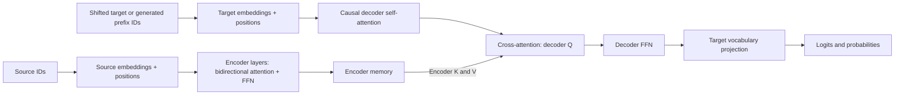

# Volume 9 — Transformer encoder and decoder

Open **Learning Studio → Transformer Encoder & Decoder**. The seven horizontal
tabs use the same navigation as M8–M10. Builder inputs, quiz drafts, notes and
saved training results survive tab changes. Training requires a button press.

## 1. Two streams built from familiar components

M8 introduced token embeddings and positional vectors. M9 introduced
`softmax(QKᵀ / sqrt(d_k) + mask)V`. M10 introduced multiple heads, the output
projection, residual paths, LayerNorm and position-wise FFNs. M11 composes them:



Residual and normalization ordering is expanded in the application's diagram,
which adapts to the chosen layer counts. Select an architecture/tensor stage to
inspect its actual shape, operation and numerical values.

## 2. Position is information

Without positions, permuting token vectors permutes self-attention outputs in
the same way. There is no absolute-position signal. For position p and dimension
pair i, sinusoidal vectors use:

`PE(p,2i)=sin(p/10000^(2i/D))`,
`PE(p,2i+1)=cos(p/10000^(2i/D))`.

For D=4, position 0 is `[0,1,0,1]`; position 1 is approximately
`[0.841471,0.540302,0.010000,0.999950]`. An embedding `[0.2,-0.1,0.3,0.4]`
at position 0 becomes `[0.2,0.9,0.3,1.4]`. These vectors are added directly in
this implementation, with no additional embedding scaling.

Learned positions use a separate trainable row for each index. They are not
sinusoids and must be learned within this model's position table. The fixed
version has no trainable positional parameters. In Concepts & Math, change
sequence length, model dimension, position mode and random seed; inspect token,
position and combined tensors and their heatmap. RoPE/ALiBi are future topics.

## 3. Encoder layer and stack

An encoder layer combines bidirectional multi-head self-attention with a
position-wise FFN. If X is `[B,S,D]`, each sublayer returns `[B,S,D]` and the
FFN hidden representation is `[B,S,FF]`. Each token can attend to every non-PAD
source key. The FFN shares its parameters across token positions.

Pre-norm encoder:

```
U = X + Dropout(SelfAttention(LN1(X)))
Y = U + Dropout(FFN(LN2(U)))
```

Post-norm encoder:

```
U = LN1(X + Dropout(SelfAttention(X)))
Y = LN2(U + Dropout(FFN(U)))
```

LayerNorm computes per-token feature mean and population variance, followed by
learnable scale and shift. Residuals preserve feature width. Layers have their
own parameters; stacking 1–4 layers retains `[B,S,D]` while changing contextual
representations. There is no extra final stack normalization here.

Choose a layer in Encoder; inspect attention, intermediate tensors, FFN
hidden values, representation changes and final memory. Compare two layers.
Random weights illustrate operations, not meaningful linguistic features.

## 4. Decoder layer and encoder memory

The decoder layer has three sublayers: causal self-attention, cross-attention
and FFN. With source length S and target length T, its input/output are
`[B,T,D]`. The encoder's final `[B,S,D]` output is **memory**, shared with every
decoder layer. Memory is a contextual source representation, not target labels
or a KV inference cache.

For pre-norm:

```
U = X + Dropout(SelfAttention(LN1(X), causal_and_target_PAD))
V = U + Dropout(CrossAttention(LN2(U), memory, source_PAD))
Y = V + Dropout(FFN(LN3(V)))
```

For post-norm:

```
U = LN1(X + Dropout(SelfAttention(X, causal_and_target_PAD)))
V = LN2(U + Dropout(CrossAttention(U, memory, source_PAD)))
Y = LN3(V + Dropout(FFN(V)))
```

Pre-norm cross-attention normalizes decoder queries' input; it does not apply
that normalization to memory. Select Decoder to inspect stages, self-attention
and source/target mask modes. Dropout acts on embeddings and residual branches,
not on attention probabilities. Inspection uses eval mode.

## 5. Three different attention patterns

| Attention | Q | K and V | Visible keys |
| --- | --- | --- | --- |
| Encoder self-attention | Source states | Same source states | All non-PAD source keys |
| Decoder self-attention | Target states | Same target states | Non-PAD keys at or before query position |
| Cross-attention | Decoder states | Encoder memory | All non-PAD source keys |

For one cross head, `Q=X_dec W_Q`, `K=M W_K`, `V=M W_V`.
If B=2,H=2,T=3,S=5,D=8, head width is 4. Q is `[2,2,3,4]`, K and V are
`[2,2,5,4]`, scores/probabilities are `[2,2,3,5]`, and each head's weighted
output is `[2,2,3,4]`. Concatenation returns `[2,3,8]`; multiplying by Wo
mixes head features while preserving D.

Worked attention example: Q=`[1,0]`, source K rows=`[[1,0],[0,1]]`,
V rows=`[[2,0],[0,4]]`. Scaled scores are `[0.707107,0]`, probabilities are
approximately `[0.669762,0.330238]`, weighted output is
`[1.339523,1.320954]`. Marking the second source as PAD gives probabilities
`[1,0]` and output `[2,0]`.

Cross-Attention shows Q/K/V, scores before and after scaling/masking, each
head output, concatenation, final multi-head output, selected query/key numerical
values and per-source value contributions. Choose a second layer/head to compare
heatmaps on the same 0–1 probability scale. Source labels are key columns;
target labels are query rows. Learned patterns can route useful information;
individual heads need not be direct linguistic alignments.

## 6. Masks and padding

This implementation uses `True=permitted` for visibility `[B,Q,K]`, expanded
across heads. Padding tensors `[B,K]` instead use `True=PAD`. For three decoder
positions the causal visibility matrix is:

```
1 0 0
1 1 0
1 1 1
```

Source padding combines with encoder visibility and cross visibility. Target
padding combines with the causal triangle. For S=5,T=3, a cross mask has 3×5
cells, so a 3×3 causal mask cannot replace it. A forbidden logit becomes `-inf`
and its probability is zero. At least one key must remain per row; all-PAD
sources or a masked first decoder key are rejected before softmax. Padded query
rows can attend valid keys; they are not all zeroed. Their PAD labels are ignored
in the loss. Valid model outputs remain finite.

## 7. Source/target tokens and teacher forcing

Synthetic vocabulary: PAD=0, BOS=1, EOS=2, then T0=3,T1=4,… . Source sequences
contain content then EOS and optional PAD. Targets additionally start with BOS.
The default copy task preserves content order; reversal flips content only.
No language dataset or tokenizer download is needed.

```
Source:          [T0,  T1,  EOS, PAD]
Target:          [BOS, T0,  T1,  EOS, PAD]
Decoder input:   [BOS, T0,  T1,  EOS]
Expected output: [T0,  T1,  EOS, PAD]
```

During teacher forcing each input position provides the correct previous token.
The causal mask prevents position 0 from seeing T0 at position 1. All target
positions can be processed in parallel; each predicts the next token. Vocabulary
logits are `[B,T,V_target]`; softmax is over vocabulary, not positions.

Cross-entropy is `-log(probability_of_expected_token)`. If the three non-PAD
correct probabilities are `[0.8,0.5,0.9]`, individual losses are approximately
`[0.223144,0.693147,0.105361]` and mean loss is `0.340550`. PAD contributes
zero and is excluded from the mean denominator. Seq2Seq & Training displays
the actual shifted IDs, logits, probabilities, predictions and per-position loss.

## 8. Training versus generation

Training uses ground-truth prefixes, cross-entropy and backpropagation through
both stacks. Inference receives only a source sequence, computes memory once,
starts at BOS and repeatedly chooses `argmax(last_position_logits)`. The chosen
token becomes the next prefix input. EOS stops that sequence; completed sequences
are padded if other batch members continue. A length limit also stops generation.
PAD and BOS cannot be generated as content. Generation uses inference mode and
does not receive future labels. Decoder prefixes are recomputed; KV caching,
beam search and sampling are outside M11.

Try default D=16,H=2,FF=32, one layer each, fixed positions, pre-norm, dropout=0,
seed=42, 150 Adam steps, batch=8, lr=0.01. A measured Windows CPU run took about
10 seconds: loss `2.278946 → 0.015437`, greedy exact match `0/16 → 16/16`.
See the completion report for validation evidence. These are fits to the 16
training examples, not held-out generalization or universal convergence claims.

Training graphs show loss, teacher-forced token accuracy, teacher-forced exact
sequence accuracy and gradient norm before clipping to 1. Predictions before
and after training use greedy decoding; their exact-match metric includes EOS
and ignores trailing padding through canonical padded comparison. The two
accuracy kinds can differ because greedy mistakes change later prefixes.

Training requires **Train tiny Transformer**. Configuration changes retain the
last run with its own settings displayed; pressing Train replaces it. **Reset
training** restores the untrained demonstration for inspection. Other tabs can
inspect the matching trained model and select a training example. Sessions never
share mutable trained models.

## 9. Parameters and complexity

The inspector groups actual `requires_grad` tensors by embeddings, position
tables, per-layer self/cross-attention, FFN, norms and vocabulary projection.
Groups are disjoint; their sum equals the total.

For bias-free MHA, parameters are `4D²`. Biased FFN parameters are
`2D*FF + FF + D`. Each affine LayerNorm contributes `2D`. An encoder layer has
two LayerNorms and a decoder layer has three. For D=8,FF=16:
encoder=`256+280+32=568`; decoder=`512+280+48=840`.
For source/target vocabularies of size 7, one layer each and fixed positions,
embeddings add `2*7*8=112` and output projection adds `8*7+7=63`, for **1583**
trainable parameters. Learned positions add separate source and target tables,
`2*max_length*D` parameters. Embedding PAD rows are included in PyTorch's parameter
count even though `padding_idx` suppresses their lookup gradients.

Per head per layer, encoder score storage is S², decoder T², and cross T*S.
For S=5,T=3,H=2, score cells are 50,18,30. QK and AV each cost approximately
S²D, T²D, and T*S*D respectively. With D=8 and one layer each, their combined
QK+AV estimate is `2*8*(25+9+15)=784` MACs per sequence. These omit projections,
FFN, activations, norm and softmax and are theoretical, not hardware timings.
Adding layers scales the corresponding model size and attention work linearly.

## 10. Architecture families, exercises and progress

Encoder-only models commonly learn representations or sequence classifiers.
Decoder-only models use causal attention to model next-token probabilities.
Encoder-decoder models combine a distinct source stream and target stream
through cross-attention, useful for translation and other sequence mappings.
These are architectural comparisons; no pretrained model family is implemented.

Complete the fifteen Quiz checks and the guided numerical experiments in
Exercises & Progress. Save notes, mark the lesson complete, and export/import
the same version-1 learning progress JSON used by earlier studios. Unsubmitted
answers and notes survive section changes. Review settings against the diagram
and actual tensors before explaining what an attention pattern means.
